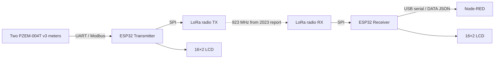
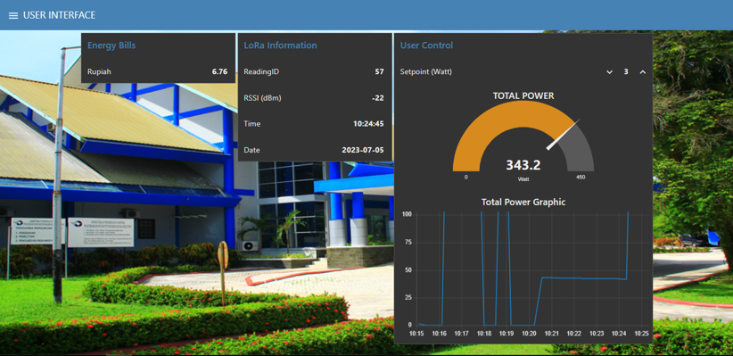
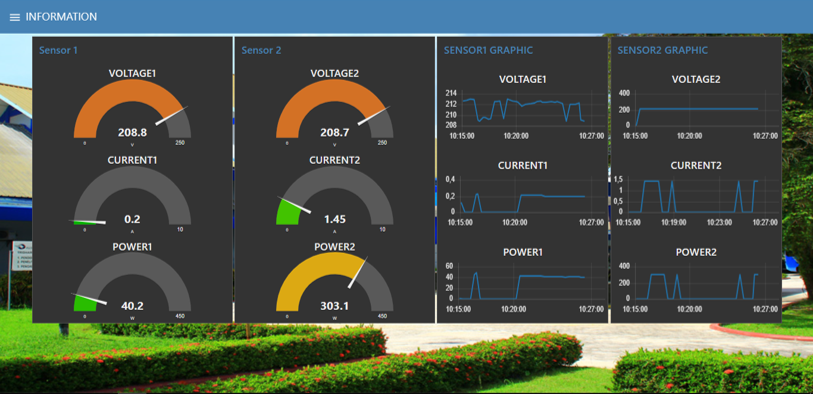
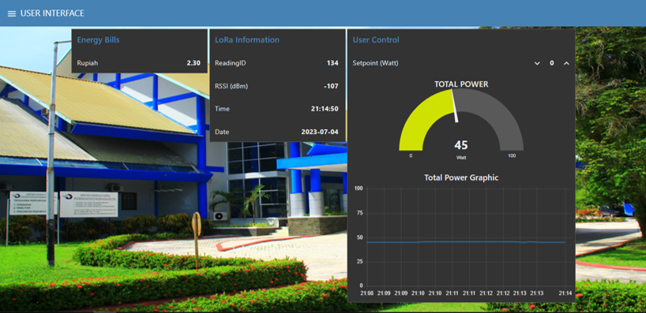
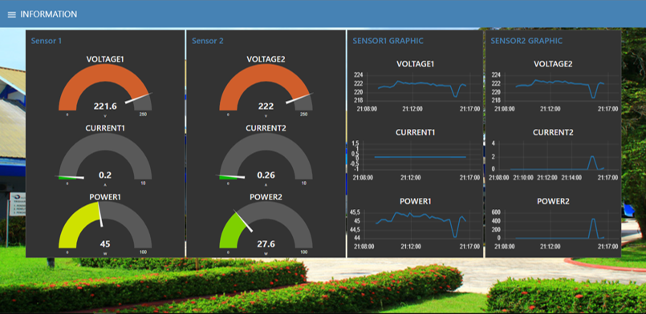

# LoRa-Based Energy Monitoring System

**Originally developed in 2023 · Reconstructed and documented in 2026**

**Status:** Source recovered from archived program listings · CSV protocol host tests passed · ESP32/PlatformIO builds and physical hardware verification pending.

This repository documents a two-node energy-monitoring prototype built around **ESP32**, **two PZEM-004T v3 energy meters**, **LoRa**, **16×2 LCD**, and a **wired serial connection to Node-RED**. The original 2023 program listings survived in an archived project report, even though the original source folder, Git history, and Node-RED flow were lost.

> **Provenance:** The files in `archive/report_transcription/` are redacted text transcriptions from the 2023 report, not original Git commits. The compilable-intent firmware, protocol tests and Node-RED demo were reconstructed/refactored in 2026. The reconstruction has been host-tested for packet format but **not yet built/flashed or verified on the original hardware**.

## What this project demonstrates

- **Embedded energy metering:** two PZEM-004T v3 meter readings via ESP32 UART/Modbus (report-derived hardware configuration).
- **Long-range wireless telemetry:** an 11-field CSV packet sent between ESP32 LoRa nodes.
- **Local and connected monitoring:** 16×2 LCDs and a receiver-to-Node-RED serial bridge.
- **Maintainable reconstruction:** shared C++ packet codec, packet validation, and host-runnable tests introduced in 2026.

## System design



## Original Node-RED dashboard (2023 screenshots)

These four screenshots are from the working monitoring interface documented in July 2023. They show **two PZEM-004T sensor channels**, instantaneous voltage/current/power, total power, LoRa reading ID and RSSI, electricity cost estimates, a user-defined power setpoint, and time-series charts.

| User interface: total power and LoRa status | Sensor information: measurements and trends |
| --- | --- |
|  |  |
|  |  |

**Documentation note:** These are original dashboard screenshots, but the **original Node-RED flow/export is unavailable**. [`dashboard/demo_flow.json`](dashboard/demo_flow.json) is a *new illustrative 2026 demonstration*, not a recovered copy of the interface shown above. Hardware and dashboard reconstruction have not yet been retested together.

## Repository layout

```text
archive/report_transcription/   extracted original-report listings (credentials redacted)
firmware/transmitter/           reconstructed ESP32 sender (PlatformIO project)
firmware/receiver/              reconstructed ESP32 gateway (PlatformIO project)
shared/telemetry_protocol.h     same 11-field CSV wire format as the 2023 report
dashboard/screenshots/          four original 2023 Node-RED UI screenshots
dashboard/demo_flow.json        2026 illustrative Node-RED flow (not original)
docs/                           provenance, safety and packet format
examples/                       synthetic telemetry sample
tests/                          C++ host protocol regression tests
```

## View the project without PlatformIO

You can browse all source code, read the documentation, and publish this repository to GitHub **without installing PlatformIO**. PlatformIO is only necessary to compile/upload the embedded firmware. The small C++ packet-codec test can be run separately with any available C++17 compiler.

## Open in VS Code (Windows)

1. Extract the ZIP to a normal folder, e.g. `C:\Users\<you>\Projects\lora-energy-monitoring`.
2. Open the extracted root folder in **Visual Studio Code**.
3. Install the **PlatformIO IDE** extension. Restart VS Code if requested.
4. PlatformIO has **two separate ESP32 projects**. Open `firmware/transmitter/` as a PlatformIO project to **Build** and, when hardware is available, **Upload**. Repeat separately for `firmware/receiver/`.
5. Use the PlatformIO serial monitor at **115200 baud**. On the receiver, lines starting with `DATA:` contain JSON telemetry for Node-RED.
6. Use `dashboard/demo_flow.json` for an offline demonstration without hardware.

**Do not upload firmware until you verify the board, wiring, sensor addresses, LoRa band, power/logic levels and library compatibility.** The `esp32dev` board setting is an assumption inferred from the ESP32 pin conventions in the report.

## Test the packet codec without embedded hardware

On a Windows computer with g++ (MinGW) installed:

```powershell
g++ -std=c++17 -Wall -Wextra -pedantic tests/test_telemetry_protocol.cpp -o telemetry_test.exe
.\telemetry_test.exe
```

On Linux/macOS:

```bash
g++ -std=c++17 -Wall -Wextra -pedantic tests/test_telemetry_protocol.cpp -o /tmp/telemetry_test
/tmp/telemetry_test
```

## Important caveats

- `TARIFF_IDR_PER_KWH` (transmitter `include/config.h`) is an **illustrative** assumed value, not a verified electricity tariff. For actual estimates, supply your valid tariff and billing assumptions.
- The code no longer resets the accumulated energy reading automatically on boot.
- Transmitter sensor addresses `0x08` and `0x07`, 923 MHz LoRa band and ESP32 pin mapping were transcribed from the report. Verify them on the original equipment.
- **Electrical safety:** PZEM meters can connect to hazardous AC mains. Do not connect/rewire mains without qualified supervision. The host tests and synthetic Node-RED flow require **no mains or radio hardware**.
- **Node-RED provenance:** Four original July 2023 screenshots document the historic UI. The Node-RED flow file provided here was newly created in 2026; it is **not** the original dashboard.
- No secrets or historical Wi-Fi passwords are included in the published code.

Read [`docs/reconstruction-notes.md`](docs/reconstruction-notes.md) before claiming the reconstruction is equivalent to the tested 2023 prototype.

## Library references

- [PZEM-004T v3 / mandulaj](https://github.com/mandulaj/PZEM-004T-v30)
- [Arduino LoRa / sandeepmistry](https://github.com/sandeepmistry/arduino-LoRa)
- [LiquidCrystal_I2C / marcoschwartz](https://registry.platformio.org/libraries/marcoschwartz/LiquidCrystal_I2C) (older LCD library: test on your board)
- [PlatformIO](https://platformio.org/)

**Code and documentation status:** 2026 reconstructed reference, not production-ready and not yet physically validated. Licensing decision is pending the author's choice; no LICENSE is included. This repository does not automatically grant reuse rights.
